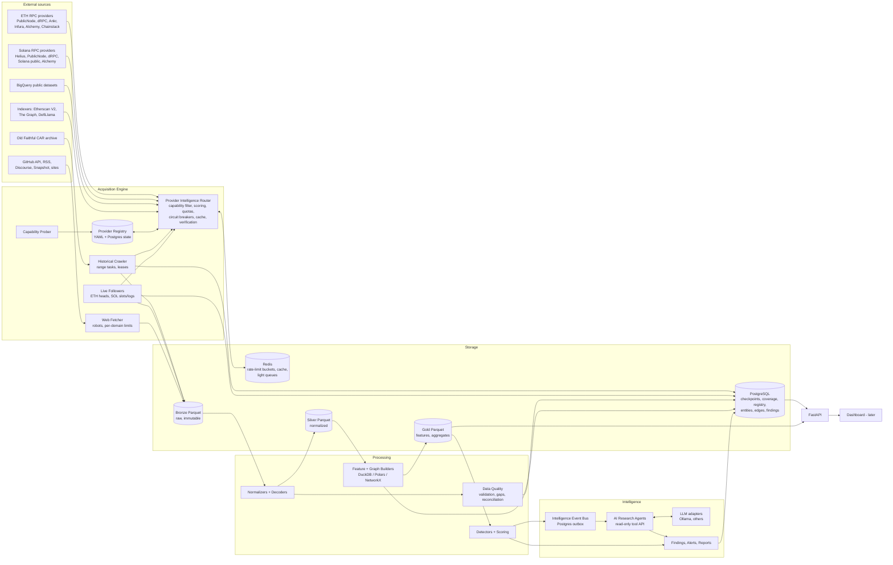

# Data Architecture (Deliverables D, F, G, H)

Version 0.1 (2026-11-03). Status: **Draft, awaiting approval.**

## 1. System architecture diagram (Deliverable H)



## 2. Layer responsibilities

| Layer | Contents | Format | Mutability |
|---|---|---|---|
| **Bronze** | Source records as received, plus an ingestion envelope | Parquet (zstd), raw JSON kept in a `payload` column for RPC responses | Immutable, append-only. Corrections are new rows, never overwrites |
| **Silver** | Normalized, chain-agnostic and chain-specific tables | Parquet (zstd) | Rebuildable from Bronze. Versioned by `normalizer_version` |
| **Gold** | Features, aggregates, graph edge tables, metrics | Parquet; hot subsets mirrored to Postgres | Rebuildable from Silver |
| **Intelligence** | Findings, evidence bundles, scores, alerts, reports | PostgreSQL (+ Markdown/JSON reports in object store) | Append-only history with status transitions |
| **Operational** | Registry state, quotas, checkpoints, coverage maps, tasks, watchlists, entities, labels | PostgreSQL | Transactional |
| **Ephemeral** | Rate-limit buckets, response cache, dedup windows | Redis | Disposable. Losing it never loses data |

## 3. Provider Intelligence Router (Deliverable D)

### 3.1 Components
- **Registry (static):** YAML files per provider endpoint (schema in `PROVIDER_REGISTRY.md` §6). Loaded and validated at startup. URLs come from env vars and pass the SSRF guard.
- **Registry state (dynamic, Postgres):** `provider_health`, `provider_usage` (per window), `provider_method_stats` (latency histogram, error rate, last error), `provider_capability_observations` (from the prober and from production responses), `provider_quality` (verification agreement rate).
- **Request model:** `ChainRequest(chain, network, method, params, priority, required_capabilities, freshness, block_ref, max_cost, idempotency_key, verification_policy)`. The router derives `required_capabilities` from the method and params. For example, `eth_getLogs` with `fromBlock < 15_537_394` requires `history_floor_block <= fromBlock`, and the span requires `max_logs_block_range >= span`. `eth_getBalance` at an old block requires `archive_state`.

### 3.2 Routing algorithm
```
route(req):
  if cache.hit(req) and fresh_enough: return cached
  C = endpoints(chain, network)
  C = filter(C, supports(method) and not blocked(method))          # capability gate
  C = filter(C, satisfies(req.required_capabilities))             # history / archive / range gate
  C = filter(C, breaker_state != OPEN and not in_cooldown)
  C = filter(C, quota_remaining(e, cost(e,req)) > reserve(e, req.priority))
  if C empty: -> NoEligibleProvider(reason set)   # caller re-queues with backoff or re-routes to another SOURCE type (e.g. BigQuery); never sends blindly
  score(e) = w_h*health + w_l*(1 - norm_latency_p50) + w_q*quality
             + w_r*quota_headroom - w_c*norm_cost + w_f*freshness_ok - w_e*recent_error_rate
  pick by weighted random over top-k (k=3) using softmax(score / T)   # spreads load, avoids herd
  acquire token from e's bucket (Redis, atomic Lua); if none -> next candidate
  send with timeout(method-specific)
  validate(response) -> {ok, invalid, partial, rate_limited, error}
  record usage, latency, outcome
  on rate_limited: honour Retry-After; cooldown(e, method); learn tighter bucket
  on error/invalid: breaker.record_failure; retry on a DIFFERENT eligible endpoint with exp backoff + full jitter (base 0.5s, cap 30s, max_attempts by priority)
  verification_policy: if sampled or required -> issue same req to independent provider, compare canonical fields
```
**Key rule:** a failover target must pass the same capability and quota gates as the original choice. "Another provider exists" is never enough.

### 3.3 Mechanisms
| Mechanism | Design |
|---|---|
| Weighted selection | Softmax over top-k scores. Weights are configurable per priority class (P0 favours latency, P4 favours quota headroom and cost) |
| Quota-aware | A token bucket per (endpoint, window) for every declared quota window (per-second, per-minute, per-day, per-month). Cost uses `method_costs`. When cost is unknown, assume a conservative default and refine from usage headers or dashboards |
| Reserve | Each endpoint keeps headroom for P0/P1 (for example, 20% of the daily budget). P4 cannot spend into the reserve |
| Circuit breaker | Per (endpoint, method-class). CLOSED → OPEN after X failures in a rolling window. HALF_OPEN after cooldown, with a single probe request |
| Cooldown | After a 429, skip the endpoint for the method class for `Retry-After` (or an escalating 30 s → 10 min) |
| Caching | Immutable responses keyed by block hash or finalized block number are cached long-term. Head-relative calls get a short TTL (≤ 2 s). `latest`-tagged responses are never cached beyond TTL |
| Response validation | JSON-RPC schema; result non-null when it should be; block number/hash match the request; `logs` within the requested range; Solana `slot <= finalized` for finalized requests; truncation detection (count equals limit means more pages exist) |
| Cross-provider verification | Policies: `none`, `sample(p)`, `always`, `on_low_quality`. Compares canonical fields (hashes, counts), not raw JSON |
| Usage accounting | Every call is persisted (aggregated per minute) to `provider_usage`. Burn-rate forecast against reset dates |
| Performance history | Rolling p50/p95 latency and error rate per (endpoint, method) in 5-min buckets, retained 90 days |
| Extensibility | New provider = new YAML + optional adapter class (auth/header quirks). Intelligence code only sees `ChainClient` |

### 3.4 Non-RPC sources
BigQuery, Etherscan, The Graph and DefiLlama are registered as `source_kind: dataset | indexer_api`, with their own quotas. BigQuery uses a **bytes-scanned budget**. Every query is dry-run first, and it is refused if `estimated_bytes > remaining_monthly_budget × safety_factor` or above a per-query cap (default 20 GiB).

## 4. Storage layout (Deliverable F)

### 4.1 Object layout
```
${BIP_DATA_ROOT}/
  bronze/chain=ethereum/dataset=blocks/range=021000000-021000999/part-<hash>.parquet
  bronze/chain=ethereum/dataset=logs/date=2026-11-03/part-<hash>.parquet        # live
  bronze/chain=solana/dataset=transactions/scope=<scope_id>/slot_bucket=<slot//432000>/part-<hash>.parquet
  bronze/web/source=github/date=2026-11-03/part-<hash>.parquet
  silver/<table>/chain=<c>/<partition>/...
  gold/<table>/chain=<c>/date=<d>/...
  manifests/<layer>/<table>.jsonl         # file -> row count, min/max keys, content hash, schema_version, lineage
```
- **Partitioning:** chain first, then dataset, then a block range (ETH history, 1,000-block granularity, merged into ≥100k-block compacted files) or a date (live). Solana uses an epoch bucket. Target file size is 128–512 MB after compaction. Small live files are compacted nightly.
- **Compression:** zstd (level 3 by default; level 9+ for cold compaction). Dictionary encoding for addresses and topics.
- **Object store abstraction:** `fsspec`/`obstore` style. Starts on local disk. The same code later targets S3-compatible storage (MinIO on a separate disk, Cloudflare R2, Backblaze B2), subject to owner approval.

### 4.2 Silver schemas (core, chain-agnostic where possible)
`blocks`, `transactions`, `receipts` (EVM), `logs` (EVM), `instructions` (Solana, including inner instructions with `stack_height`), `traces` (EVM, where available), `token_transfers`, `native_transfers`, `contracts` (deployments), `tokens`, `swaps`, `liquidity_events`, `account_balance_observations`.

Common columns: `chain`, `network`, `block_number|slot`, `block_hash|blockhash`, `block_time`, `tx_id` (hash or signature), `position` (tx_index, log_index or instr path), `status` (`observed|finalized|orphaned`), plus the provenance envelope (§6).

### 4.3 Gold datasets (initial)
`wallet_daily_activity`, `wallet_counterparty_edges`, `wallet_funding_edges` (first funder, funding paths), `token_daily_metrics` (holders where coverage permits, transfers, volume), `whale_movements`, `cex_flows`, `stablecoin_flows`, `contract_deployments_enriched`, `developer_profiles`, `protocol_daily_metrics` (from DefiLlama plus on-chain), `anomaly_scores`, `opportunity_candidates`.

### 4.4 PostgreSQL (operational + high-value)
Schemas: `registry` (provider state, usage), `ingest` (tasks, leases, checkpoints, coverage intervals, incidents), `entity` (addresses of interest, entities, clusters, labels with evidence), `graph` (edges, de-duplicated and aggregated, with refs into Parquet evidence), `intel` (findings, evidence bundles, scores, alerts, reports, agent runs), `app` (watchlists, scopes, users later).
Rule: no table holds per-transaction chain-wide data. Postgres holds **entities of interest and aggregated edges**. Bulk rows stay in Parquet.

### 4.5 Redis (from Stage 3)
Token buckets (atomic Lua), short-TTL response cache, dedup sets for live events (TTL ≈ 2× reorg window), and lightweight work queues (or Postgres `SKIP LOCKED` queues; ADR-006). `maxmemory` is capped (e.g. 512 MB) with `allkeys-lru` for cache keys only.

### 4.6 What to keep, compress, aggregate, index, reconstruct, never discard
| Category | Policy |
|---|---|
| **Never discard** | Bronze for in-scope data; checkpoints; coverage maps; provenance; findings with evidence; verification incidents; orphaned-block records |
| **Compress** | All Parquet (zstd). Raw JSON payload column (zstd, high level) for cold partitions |
| **Aggregate** | Live high-volume, out-of-scope data (e.g. chain-wide small transfers) goes to daily aggregates. Raw rows are dropped after N days only if declared `ephemeral` in the scope config |
| **Index** | Postgres B-tree on addresses, entities, task/coverage keys. Parquet min/max stats plus sort by (address, block) for transfers. Optional Bloom filters on address columns |
| **Reconstruct** | Silver and Gold are always rebuildable from Bronze (versioned normalizers). Response cache is disposable |
| **Retention** | Bronze in-scope: indefinite. Bronze ephemeral: 30 days (proposed). Live small files: compacted after 1 day. Performance metrics: 90 days |

### 4.7 Backup and recovery
- **Postgres:** nightly `pg_dump` (custom format), compressed, plus WAL archiving once there is a second disk. Restore is tested monthly (roadmap Stage 13).
- **Parquet:** immutable files plus manifest hashes, which allows incremental sync (rclone) to a second location. Silver/Gold need no backup because they can be reconstructed. Back up Bronze and manifests.
- **Recovery drill:** restore Postgres, verify manifests against files, run the gap scanner, then resume tasks.

## 5. Processing pipeline

```
Bronze --(normalizer vN, chain adapter)--> Silver --(feature jobs)--> Gold --(detectors)--> Intelligence events
             |                                  |                          |
         validation                        dedup/entity              scoring + evidence bundling
```
- **Engine:** DuckDB for SQL over Parquet (partition pruning, out-of-core). Polars for dataframe transforms. Jobs are incremental by partition and driven by manifests: a partition is reprocessed only when an input manifest hash changes.
- **Validation:** schema checks (pydantic/pyarrow schema), domain checks (non-negative values, unique keys, referential checks such as logs→tx).
- **Dedup:** on natural keys (§6.2). Bronze may contain duplicates from multiple providers; Silver keeps one canonical row with `source_count` and `sources`.
- **Normalization and decoding:** ABI decoding for known event signatures (ERC-20/721/1155, Uniswap V2/V3 and others), from an ABI registry populated from verified sources. Unknown events are kept undecoded.
- **Enrichment:** labels (CEX wallets from public, evidenced lists), token metadata, prices.
- **Entity resolution:** rule-based clustering (common funder, deployer→contract, Solana fee payer patterns, CEX deposit-address heuristics). Every cluster stores the rule id and evidence. Clusters are hypotheses unless the rule is deterministic, such as contract ownership.
- **Feature engineering, anomaly detection:** robust z-scores and seasonal baselines first. scikit-learn (IsolationForest) later. PyTorch only with a justified ADR.
- **Quality scoring:** per partition — `completeness = covered/target`, `agreement` (verification rate), `freshness`.
- **Lineage:** every Silver/Gold file manifest lists its input file hashes and job version. Findings reference evidence rows by `(table, partition, natural key)`, together with the raw Bronze ref.
- **Reprocessing:** bump `normalizer_version`, rebuild affected partitions into a new version path, swap the manifest pointer atomically, and keep the old version until it has been verified.

## 6. Data quality and provenance

### 6.1 Provenance envelope (Bronze, carried into Silver)
`chain`, `network`, `block_number|slot`, `block_hash`, `tx_id`, `source_kind` (rpc/dataset/indexer/web), `source_provider`, `source_endpoint_id`, `source_method`, `request_id`, `collected_at`, `event_time` (block_time), `ingestion_method` (historical/live/on_demand/verification), `finality` (observed/confirmed/finalized/orphaned), `verification_status` (unverified/single_source/cross_verified/conflict), `schema_version`, `raw_ref` (file + row or payload hash), `content_hash`.

### 6.2 Natural keys
- EVM block: `(chain, block_hash)`
- EVM tx: `(chain, tx_hash)`
- EVM log: `(chain, block_hash, log_index)`
- Solana tx: `(chain, signature)`
- Solana instruction: `(chain, signature, outer_index, inner_index)`

### 6.3 Mechanisms
- **Missing ranges:** coverage interval sets plus the gap scanner (`DATA_ACQUISITION_STRATEGY.md` §4.4).
- **Conflicts:** conflicting records are quarantined into a `dq_conflicts` table with both versions and resolved by tiebreak. The losing provider's quality score drops.
- **Reorgs:** orphaned status propagates to Silver/Gold through correction events. Detectors re-run on affected partitions.
- **Completeness:** reported with every metric. For example, "holder count (coverage 97.2%, from block X)". UIs and reports must display it.
- **Null discipline:** unknown means `NULL` plus a reason. Aggregates over incomplete coverage carry `is_partial = true`.

## 7. Technology selection (smallest viable stack)

| Tech | Decision | Rationale |
|---|---|---|
| Python 3.12 | **Adopt** | Ecosystem for data/ML/web3 |
| httpx + asyncio | **Adopt** | Async JSON-RPC with fine-grained control. SDKs are not needed for raw RPC |
| Web3.py | Adopt (narrow) | ABI decoding/encoding utilities only, not for transport |
| solders / solana-py | Adopt (narrow) | Types, signature/pubkey parsing. Transport via own client |
| pydantic / pydantic-settings | **Adopt** | Validation, config |
| PostgreSQL 16+ | **Adopt** | Operational and high-value data. Also a viable job queue |
| Apache Parquet + zstd (pyarrow) | **Adopt** | Lake format |
| DuckDB | **Adopt** | Embedded analytical SQL over Parquet. No server |
| Polars | **Adopt** | Fast transforms |
| Redis | Adopt at Stage 3 | Shared rate-limit state across processes. Until then, in-process buckets |
| FastAPI | **Adopted in Stage 1b** (ADR-016) | API for the dashboard, watchlists, investigations and findings |
| SQLite + SQLAlchemy Core | **Adopted in Stage 1b** (ADR-015) | Prototype operational store. Portable to PostgreSQL |
| Docker (compose) | Adopt for deployment | Reproducible; resource limits (cpus/mem) to protect the VPS |
| NetworkX | Adopt at Stage 11 | Graph analytics on extracted subgraphs (not the whole chain) |
| scikit-learn | Adopt at Stage 11–12 | Anomaly detection, clustering |
| Ollama | Optional adapter, Stage 15 | Local LLM. The VPS already hosts models (reuse, don't re-download) |
| Playwright | Defer | Only for allow-listed JS-heavy sites |
| Scrapy | Defer | Thin fetcher is enough initially |
| ClickHouse | **Defer** | Justified when interactive queries over >~10B rows need sub-second latency, or concurrent users exceed DuckDB's single-process model |
| PyTorch | Defer | Only for learned models with labelled data |
| React + Vite + TypeScript | **Adopted in Stage 1b** (ADR-016) | Static SPA dashboard. Next.js is not used |
| Kafka, Kubernetes, Elasticsearch, Neo4j | **Reject for now** | Not justified by current volume. Postgres outbox + Parquet + NetworkX covers these needs |

## 8. Deployment topology

**Initial:** a single host. One compose project with containers `bip-postgres`, `bip-redis` (Stage 3+), `bip-acquire` (router, live and historical workers as async tasks), `bip-process` (scheduled DuckDB/Polars jobs) and `bip-api` (later). CPU and memory limits are set so existing VPS workloads keep priority (proposed: 3 vCPU, 6 GB RAM in total).
**Later:** workers scale horizontally because task leases live in Postgres and buckets live in Redis. Storage moves to a separate volume or S3-compatible store by changing `BIP_DATA_ROOT`/URI only.

## 9. Scale and cost analysis (Deliverable G)

All figures are **estimates** derived from explicit assumptions. They must be replaced by measured values in Stage 5 (measure Parquet bytes per row on real data).

**Per-row assumptions (compressed Parquet, zstd, sorted):** ETH tx ≈ 150–250 B. ETH log ≈ 80–150 B. ETH token transfer (Silver) ≈ 60–100 B. Solana tx (Silver, without raw JSON) ≈ 200–400 B. Raw JSON payload adds roughly 3–6× unless dropped after normalization. **Volume assumptions:** ETH ≈ 1–2M tx/day and 4–8M logs/day (assumption). Solana ≈ 1,000 non-vote TPS ≈ 86M tx/day (a 2025 figure seen in search results, original source not confirmed; to be measured).

### Scenario 1 — Small prototype (fits ~$0, but not on the current VPS disk long-term)
- ETH: headers chain-wide (live), full blocks and receipts for the last 30 days for ~50 watched contracts plus chain-wide ERC-20 transfers above a USD threshold. Solana: ~20 scoped programs or wallets, 90 days.
- Storage estimate: Bronze 5–20 GB, Silver/Gold 2–8 GB, Postgres < 2 GB.
- Requests: ~20–60k/day across 4–6 providers, which is within free tiers per the registry.
- **Caveat:** the VPS has ~8 GB free (≈6% of 145 GB). The prototype should cap `BIP_DATA_ROOT` at ~5 GB with hard disk guards, or use separate storage.

### Scenario 2 — Serious two-chain intelligence system
- ETH: chain-wide blocks, transactions, logs and token transfers from the Merge (Sep 2022) onward, plus scoped pre-Merge. Solana: scoped at a few hundred programs and tokens, plus whale wallets, full history for scope.
- ETH estimate: ~1.5M tx/day × 365 × ~3.2 years ≈ 1.75B tx → ~0.3–0.45 TB; logs ≈ 4–9B rows → ~0.4–1.3 TB. Total ETH Silver+Bronze (normalized, raw JSON dropped after verification) ≈ **1–2.5 TB**.
- Solana scoped ≈ **0.2–1 TB**, depending on scope breadth.
- Acquisition: post-Merge ETH chain-wide backfill via free RPC is about 23M blocks × 2 calls ≈ 46M+ requests (≈ months at polite free-tier rates), or targeted BigQuery slices. BigQuery's free 1 TiB/month of scanning would not cover exporting the full logs table (multi-TB scan), and exports need a billed GCS bucket with paid egress. **Time and storage, not quota, are the constraint.**
- **Needs paid resources:** a 2–4 TB storage volume or object storage (paid at this size; R2/B2 free tiers are ~10 GB). Possibly a paid RPC plan to finish the backfill in weeks rather than months. **Requires owner approval.**

### Scenario 3 — Large multi-chain (ETH, SOL, Base, Arbitrum, BNB)
- Base, Arbitrum and BNB each generate transaction volumes comparable to or above Ethereum's. Chain-wide coverage plausibly needs **10–50+ TB**, plus a column store (ClickHouse) for interactive queries and dedicated ingestion hosts.
- Options at this scale: self-hosted Reth/Erigon archive nodes (2–3 TB+ each, NVMe), paid data providers, or a hybrid. **Not feasible at $0.**

### What stays free vs. what eventually costs money
| Remains feasible at $0 | Eventually requires payment |
|---|---|
| Live ETH head-following, scoped history, Solana scoped live and history | More than ~10 GB of durable off-VPS storage |
| Router across 6–10 free providers | Full post-Merge ETH backfill in weeks (paid RPC) or a self-hosted node (disk) |
| DuckDB/Polars processing on the VPS (with CPU caps) | Full Solana history beyond scoped extraction |
| Web intelligence via official APIs | Multi-chain chain-wide coverage, ClickHouse cluster |
| Local LLM via existing Ollama | Hosted LLM APIs at volume |

## 10. AI integration boundary
Detectors emit `IntelligenceEvent`s into a Postgres outbox. An agent orchestrator, running later in its own process, picks events above a significance threshold. It assembles an evidence bundle (bounded rows plus refs), calls an LLM adapter, and writes a `finding` with `claims[]`, each claim with a label and `evidence_ids`. A verifier step checks that each cited ID exists and supports the claim through deterministic checks where possible. Agents use a whitelisted tool API (see `SECURITY_ARCHITECTURE.md` §7).
